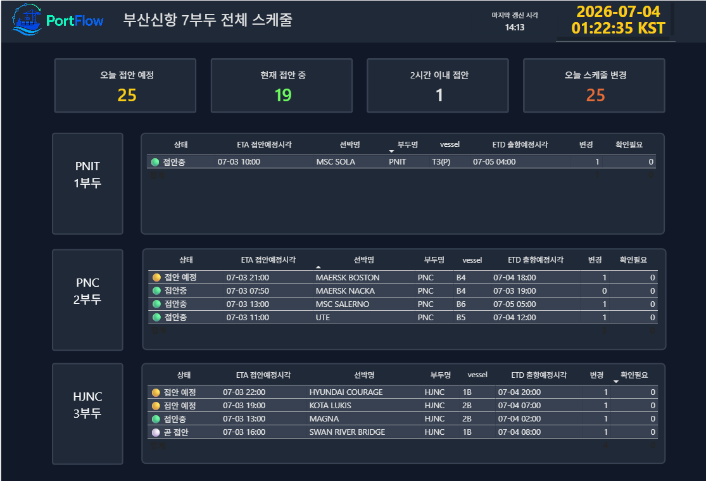
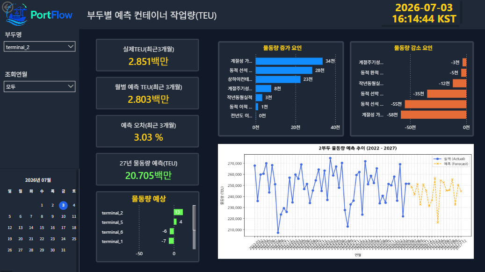
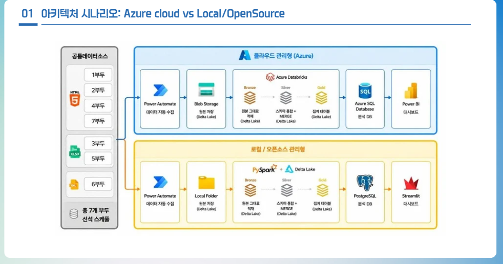
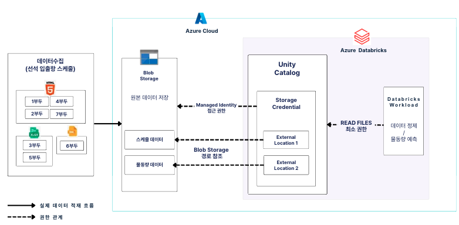

# 🚢 PortFlow
### Azure-Based Busan New Port Schedule Integration & Workload Prediction

> 부산신항 7개 부두의 분산된 선석 스케줄을 통합하고, 스케줄 변경 이력과 컨테이너 작업량을 조회·예측하는 Azure 기반 데이터 서비스입니다.

본 저장소는 팀 프로젝트 결과물 중 제가 핵심 담당한 **Azure Blob Storage–Databricks 간 Identity 기반 데이터 접근 구조 설계 및 Unity Catalog 권한 관리**를 중심으로 정리한 개인 기술 포트폴리오입니다.

 

## 1. Project Overview

부산신항 7개 부두의 선석 스케줄은 각 터미널 운영사별로 분산되어 있어, 현장 담당자가 입출항 일정과 변경사항을 확인하려면 여러 시스템을 개별적으로 조회해야 합니다.

본 프로젝트에서는 현직자 인터뷰를 통해 요구사항을 정의하고, 7개 부두의 선석 스케줄과 컨테이너 작업량 데이터를 통합하는 **PortFlow** 서비스를 구축했습니다.

Azure Blob Storage, Azure Databricks, Azure SQL Database, Power BI를 연결하여 데이터 수집·정제·저장·시각화로 이어지는 파이프라인을 구현했습니다.

### Project Goals

- 부산신항 7개 부두의 선석 입출항 스케줄 통합
- 1시간 단위 데이터 자동 갱신
- 선박별 입출항 예정시각 및 스케줄 변경 이력 조회
- 부두별 컨테이너 작업량 집계 및 예측
- Power BI 기반 통합 모니터링 대시보드 구현

 

## 2. Architecture

Azure Blob Storage → Azure Databricks (Bronze / Silver / Gold) → Azure SQL Database → Power BI

 

## 3. My Role

**My Focus: Secure Data Access**

Managed Identity → Storage Credential → External Location → Unity Catalog Permissions

전체 데이터 파이프라인 중 **Azure Blob Storage와 Databricks 사이의 인증 및 데이터 접근 경로**를 담당했습니다.

Storage Key나 SAS Token을 코드에서 직접 사용하지 않고, Managed Identity와 Unity Catalog를 통해 자격증명과 데이터 접근권한을 분리했습니다.

| 영역 | 기여 형태 | 담당 내용 |
|---|---|---|
| Service Planning | 공동 기획 | 현직자 인터뷰 추진 및 요구사항 정의 참여 |
| Data Architecture | 공동 설계 | Azure 기반 End-to-End 데이터 아키텍처 검토 |
| Storage Authentication | **개인 핵심 담당** | Managed Identity 기반 Storage Credential 구성 |
| Data Access Management | **개인 핵심 담당** | External Location 구성 및 Blob Storage 접근 경로 연결 |
| Unity Catalog Permissions | **개인 핵심 담당** | READ FILES 권한 설정 및 데이터 접근 검증 |

 

## 4. Secure Data Access Architecture ⭐

> **Primary Owner — Managed Identity · Storage Credential · External Location · Unity Catalog**

 

### 4.1 Problem — 코드에 포함된 Storage 인증정보

초기에는 팀원들이 Azure Blob Storage에 접근하기 위해 Storage Key 또는 SAS Token을 Databricks Notebook 코드에 직접 입력하고 있었습니다.

이 방식은 Notebook 공유나 소스코드 관리 과정에서 인증정보가 노출될 위험이 있으며, 사용자별 데이터 접근권한을 관리하기 어렵다는 한계가 있었습니다.

이에 인증정보와 데이터 처리 코드를 분리하고, 사용자가 필요한 데이터에만 접근하도록 구조를 개선했습니다.

 

### 4.2 Solution — Identity 기반 접근 구조 구축

 

**1. Managed Identity 기반 인증**

- Azure Managed Identity를 활용한 Storage 인증 방식 구성
- Azure RBAC를 통해 Storage 접근권한 설정
- 사용자 코드에서 Storage Key·SAS Token 제거

 

**2. Storage Credential 및 External Location 구성**

- Databricks Unity Catalog에서 Storage Credential 생성
- External Location을 통해 Blob Storage 경로 연결
- 데이터 접근 시 인증정보를 코드에 직접 입력하지 않는 구조 구현

 

**3. Unity Catalog 기반 권한 관리**

- 팀원에게 원본 파일 조회에 필요한 `READ FILES` 권한 부여
- 원본 데이터 보존을 고려해 읽기 중심의 접근권한 구성
- 권한이 없는 사용자와 권한이 부여된 사용자의 접근 동작 검증

 

### 4.3 Result — 인증정보 분리 및 최소권한 검증

- **Credential Isolation:** Storage Key·SAS Token을 사용자 코드에서 제거
- **Access Validation:** Databricks에서 7개 부두 원본 파일 정상 조회 확인
- **Permission Validation:** 권한 없는 사용자 접근 차단 및 권한 부여 후 정상 조회 검증

이를 통해 인증정보를 코드에 직접 노출하지 않으면서도 팀원들이 공통 데이터에 접근할 수 있는 환경을 구축했습니다.

**[Notebook 링크 삽입]**

 

## 5. Service Planning & Requirements

> **Collaborative Contribution — Field Requirements**

부산신항 현직자 인터뷰를 추진해 기존 업무에서 발생하는 데이터 조회 문제와 서비스 요구사항을 확인했습니다.

현장에서는 부두별로 분산된 스케줄을 개별 조회해야 했으며, 변경된 입출항 일정을 한눈에 파악하기 어렵다는 문제가 있었습니다.

이를 바탕으로 다음 요구사항을 정의하고 팀의 서비스 기획에 반영했습니다.

- 7개 부두 선석 스케줄의 통합 조회
- 1시간 단위 데이터 갱신
- 선박별 입출항 일정 및 변경사항 확인

이후 팀원들과 요구사항을 공유하고 PortFlow 대시보드 기획에 참여했습니다.

 

## 6. Results & Validation

| 검증 항목 | 결과 |
|---|---|
| Storage 인증 | Managed Identity 기반 접근 구성 |
| 인증정보 관리 | Notebook 코드 내 Key·SAS Token 제거 |
| 데이터 접근 | 7개 부두 원본 파일 정상 조회 |
| 권한 통제 | 미인가 사용자 접근 차단 확인 |
| 사용자 권한 | READ FILES 부여 후 정상 조회 확인 |

 

**Key Takeaway**

단순히 데이터가 정상적으로 처리되는 것뿐 아니라, **데이터 접근 과정에서 발생할 수 있는 인증정보 노출과 권한 관리 위험을 고려하여 접근 구조를 설계하고 검증한 경험**입니다.

 

## 7. Repository Structure

**[개인 GitHub Repository 구조 삽입 예정]**

본 저장소는 개인 담당 작업과 검증 자료를 중심으로 구성하며, 팀 전체 서비스 구현 및 상세 기능은 팀 공통 README에서 확인할 수 있습니다.

**Team Project README:** [링크 삽입]

---

*Microsoft Data School 4기 · 2차 팀 프로젝트 · 2026.06–07*
